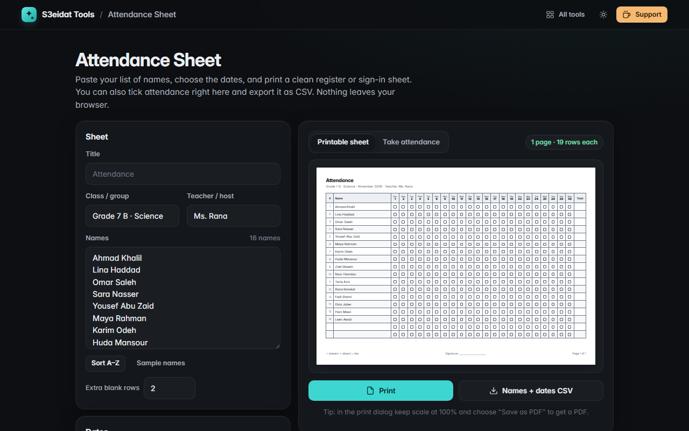

# Attendance Sheet

> Printable attendance registers and sign-in sheets. Free, private, and it runs entirely in your browser.

### ▶ [Open Attendance Sheet](https://s3eidat.github.io/attendance-sheet/)



## Features

- **Paste your names**, one per line (straight from a spreadsheet; leading numbers like `1.` are removed), sort A–Z, add extra blank rows
- **Date columns** for a whole month, a number of sessions from a start date, or blank numbered columns
- **Skip weekdays** you don't meet (weekends, or any day)
- **Tick boxes, empty cells or signature columns**, with row numbers and a total column
- **A4 or Letter, landscape or portrait**, laid out in millimetres with `@page`; long lists continue on extra pages, and dates that don't fit across one page continue on the next page with the same names
- **English or Arabic** labels; Arabic sheets are laid out right to left
- **Take attendance on screen**: click cells to mark present, absent or late, mark a whole date present, see totals, then **export CSV** (opens in Excel with Arabic intact) or print the sheet with your ticks filled in

## Privacy

Names and ticks never leave your device. Settings and ticks are kept in this browser's local storage only.
There is no server, no account, no analytics. The page ships with a strict Content-Security-Policy
(`connect-src 'self'`), so the browser itself blocks any attempt to send data anywhere.

## Run it yourself

It's plain HTML, CSS and JavaScript with no build step:

```bash
git clone https://github.com/s3eidat/attendance-sheet
cd attendance-sheet
python -m http.server 8000
```

Then open http://localhost:8000.

## Support

If this saved you time, **[buy me a coffee ☕](https://s3eidat.github.io/coffee/)**. It keeps every tool free.

---

Part of **[S3eidat Tools](https://s3eidat.github.io/)**: 100+ free, private tools that run in your browser. MIT licensed.
